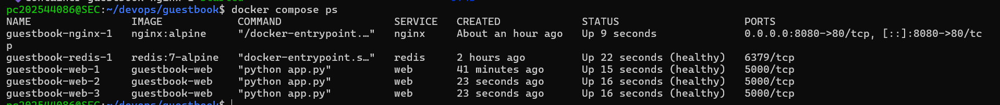
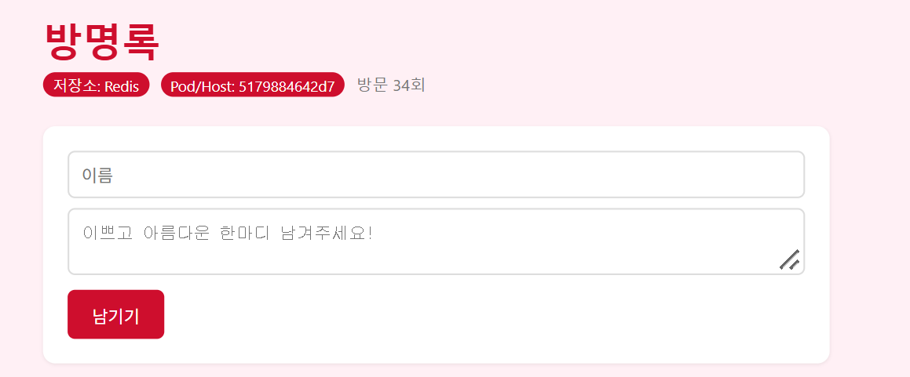
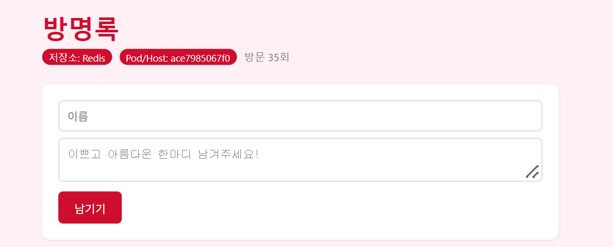
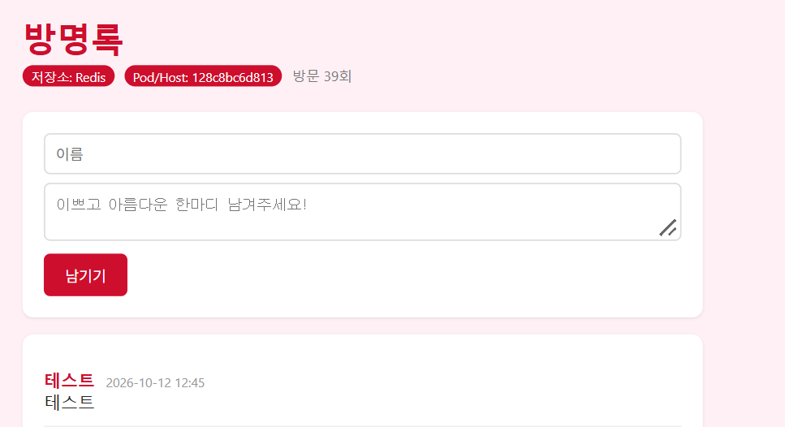
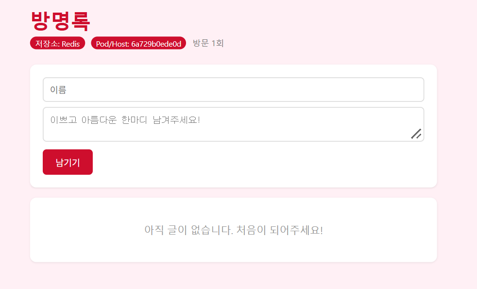

# week07 Doker Compose

## 1. docker compose ps 결과

## 2. scale 후 각 웹 컨테이너 호스트명이 바뀐 화면 결과

## 3. down 후 up과 down -v 후 up 차이 비교
down 후 up은 방명록에 쓴 글이 유지되지만(Redis볼륨 유지),
down -v 후 up은 방명록이 초기화된다(Redis볼륨 함께 삭제).

## 4. .env를 Git에 올리지 않는 이유 적어보기
.env 파일에는 redis 비밀번호와 같은 민감한 정보가 저장되어
있다. 이를 Git에 올리면 비밀번호가 외부에 노출되어 보안 상
문제가 발생할 수 있다. 따라서 .gitignore에 .env 파일 등록해
Git에 업로드되지 않도록 해야한다.
