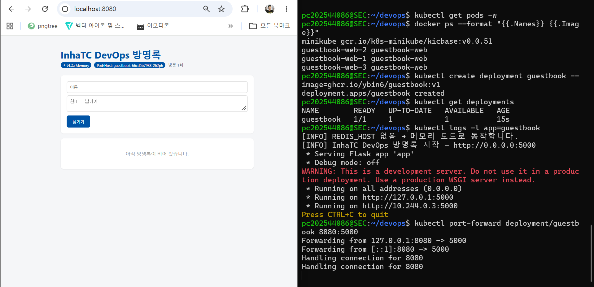

## 1,kubectl get nodes 결과

## 2,Pod 지운 뒤 새 Pod 태어난 get pods -w 화면 확인

## 3,내 방명록이 쿠버네티스에서 뜬 브라우저 화면

## 4,"선언형"을 본인 언어로 한 줄(일상 속 예시 하나 포함, 선택 사항)
난방 24도로 설정하면 자동으로 유지되는 것처럼
자신이 원하는 결과를 미리 설정하면,
시스템이 그 상태를 자동으로 유지하는 것이다.
