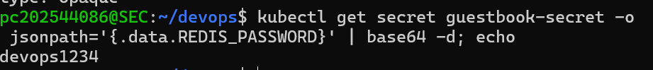
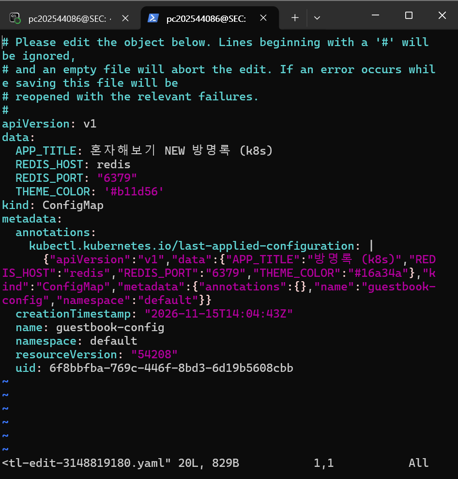
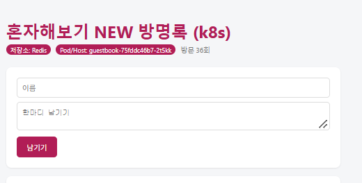
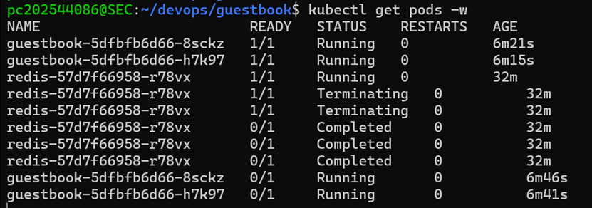

# DevOps 11주차 실습

## 1. Secret 확인

Secret은 base64로 인코딩되어 있지만 암호화된 것은 아님
base64 -d를 사용하면 원래 비밀번호를 확인할 수 있으니
완전히 안전한 방법은 아님

## 2. ConfigMap 설정 변경

ConfigMap에서 제목과 색상을 변경하고 Deployment를
재시작하니 변경된 설정이 적용됨

## 3. readiness 실패 실험

Redis를 중지하자 guestbook의 READY가 0/1로 변경됨
앱은 실행 중이지만 요청을 받을 준비가 되지 않은 상태

## 4. liveness 실패 실험

livenessProbe의 경로를 잘못 설정하니 검사가 실패해
컨테이너가 재시작되고 RESTARTS가 증가함

## 5. 트러블슈팅 3단 루틴

1. get: Pod의 상태를 확인한다
2. describe: Pod의 Events를 확인하여 오류 원인을 찾는다
3. logs: 애플리케이션의 로그를 확인하여 문제를 파악한다
